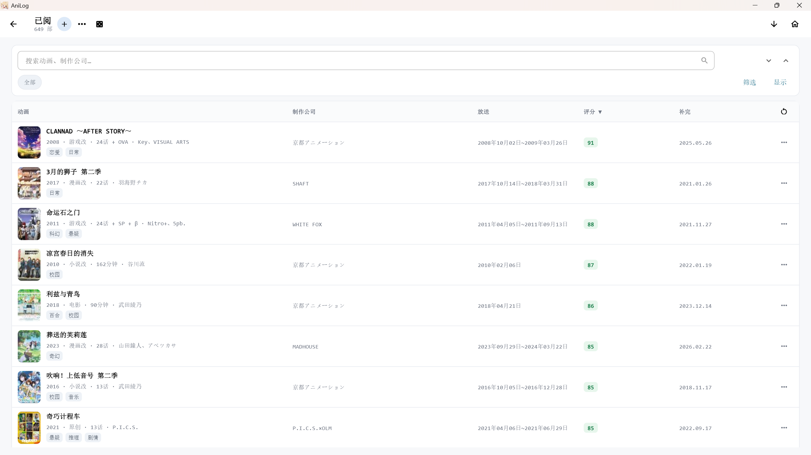
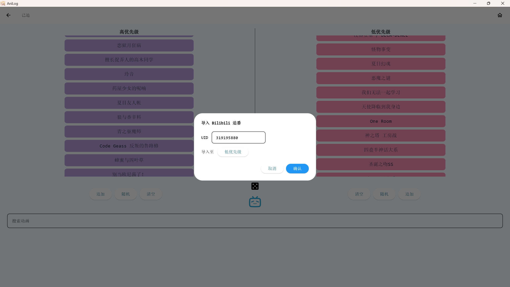
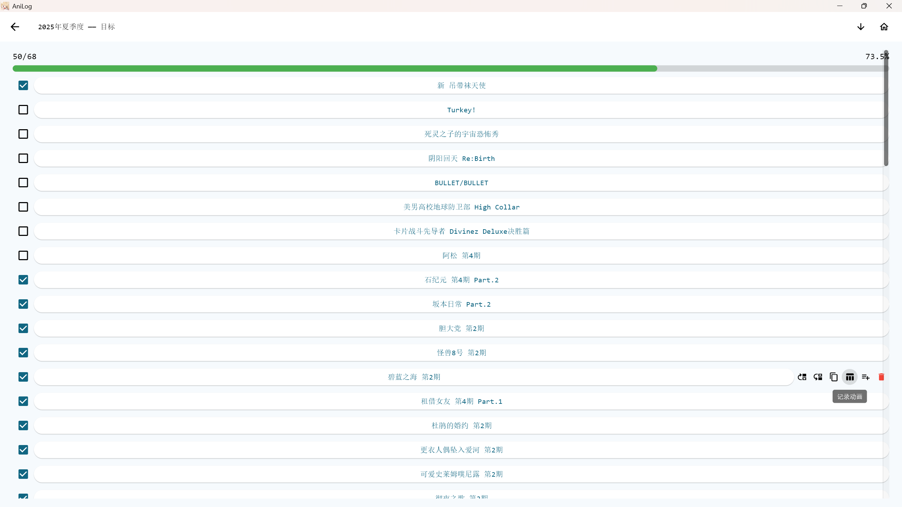
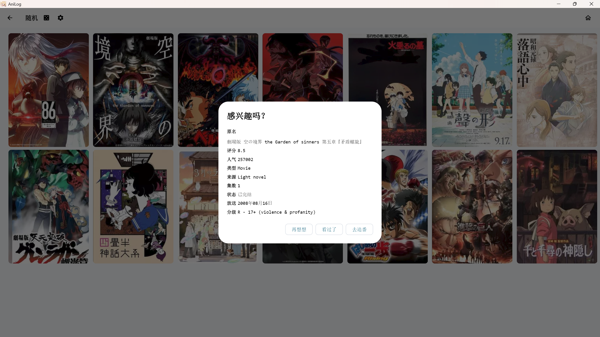
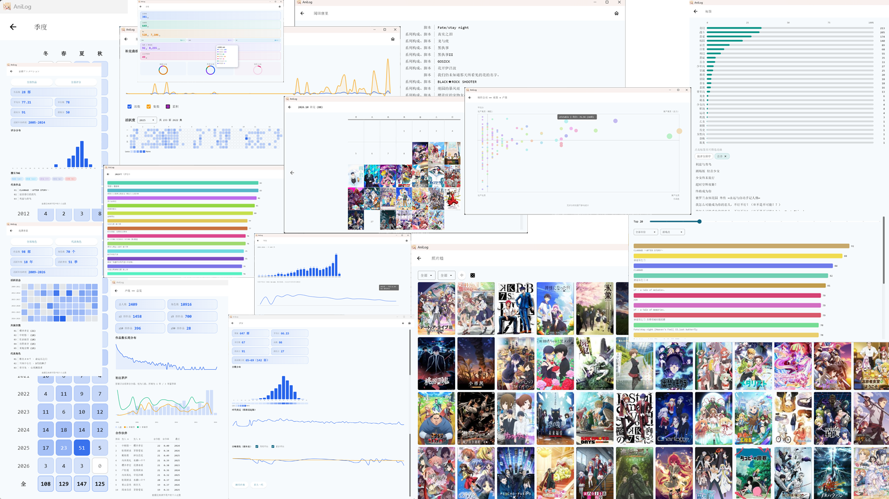

# AniLog

AniLog 是一个本地优先的动画观看记录应用：记录看过的动画、整理追番清单、浏览当季新番，并用统计视图回顾自己的观看轨迹。本项目的部分内容支持从 `Tenrai API` `Bangumi` `yuc.wiki` `Bilibili` 导入数据。

支持 `Windows` 和 `Android` 多端


> **当前版本**：`v2.1`

因为个人一直在手动记录看番经历，不想用网站，同时苦于追番待看列表一直不统一，而最近又在整个季度整个季度地刷新番旧番，为了有个喜欢的方便统一美观的工具，就花了三四天在空闲时间写了这个小工具（导出的 `Windows` 和 `Android` 端程序大小已经尽力压缩了，但碍于开发框架限制，实在抱歉想让它更小也下不去了）。

本项目 99% 以上的代码由 AI（`DeepSeek` 为主）辅助生成；我主要负责产品设计、需求拆解、UI 调整与程序调试。

## 亮点

- **深度交互**：作品、角色、声优、制作公司、TAG、放送/季度之间可任意下钻，返回自动刷新。详见[「深度交互」](#深度交互任意跳转逐层下钻)。
- **联网导入**：`Bangumi` 填充、`Bilibili` 追番/已看导入、`Tenrai` 随机动画、`yuc.wiki` 当季新番。
- **本地优先**：无账号，数据保存在本地 `storage/`。
- **多端同步**：不同设备之间可通过局域网同步数据。也可直接导入/导出应用数据。

## 功能特性

### 深度交互：任意跳转、逐层下钻

- **全站互链**：作品 ↔ STAFF ↔ 声优 ↔ 制作公司 ↔ TAG ↔ 放送/季度 等，任意条目都能互相下钻；从任意层级返回都会刷新数据。
- **统计页可下钻**：榜单、横条、直方图都是入口，不是静态图表。

常见导航链路：

```text
已阅 → 作品详情 → 声优 → 声优主页 → 某年角色 → 角色详情 → 作品详情
统计 → 放送 → 年份/季度 → 季度作品 → 作品详情 → 封面图
统计 → 制作公司 → 公司主页 → 评分分布 → 分数段作品列表 → 作品详情
```

### 搜索能力

- 支持拼音搜索（全拼 / 首字母）。
- 平假名与片假名互通，罗马音可搜假名和汉字。
- 英文可搜常见外来语。
- 支持混合搜索，例如「中shima」可命中「中島」。

### 已阅（核心）

管理已经看完或正在看的动画条目。

| 功能 | 说明 |
| --- | --- |
| 搜索与定位 | 搜索高亮，支持上下跳转到匹配项 |
| 筛选与排序 | 按条件筛选、按字段排序 |
| 条目编辑 | 追加、编辑、删除、在当前条目上方插入 |
| `Bangumi` 填充 | 搜索 `Bangumi` 后自动填充名称、封面等字段 |
| 批量导入 | 从文本或 `Bilibili` 追番导入，先分组预览再确认写入 |
| 表格导入导出 | 使用 `Excel` / 表格文件批量导入或导出记录 |
| 高互动性 | 几乎所有组件和文本都有悬浮动画以及点击事件 |

想做但懒得做：从 `Bangumi` 账户批量导入



### 已追

维护“想看但还没看”的清单。

- **高 / 低优先级两列**：分别管理不同优先级的追番。
- **状态标记**：标记动画看完（去记录）或弃坑。
- **拖动排序**：直接调整条目顺序。
- **随机抽取**：从追番列表中随机挑一部。
- **`Bilibili` 导入**：读取 `Bilibili` 追番数据并写入对应优先级。



### 追季

- 以季度分组记录动画列表，可标记是否观看，并实时跟踪进度。
- 以总览形式浏览当季作品，便于快速了解本季有哪些动画。
- 支持从网络抓取当季新番信息（数据来源 `yuc.wiki`）。
- 支持查看未来计划内的新番（数据来源 `yuc.wiki`）。



### 随机

从 `Tenrai` 随机获取动画，用于“下一部看什么”的灵感，或在你想记录动画但回忆不起来时给你提供可能的选项。

- **设置页预设**：热门、知名、常见、佳作、优秀、一般、小众、年代。
- **多选条件**：类型、状态、分级、来源、配音、季度。
- **双端滑块**：评分、人气、年份区间。
- **封面瀑布流**：按窗口尺寸自动排列封面。
- **感兴趣弹窗**：
  - 「看过了」→ 打开条目页并带入动画名；
  - 「去追番」→ 选择高 / 低优先级后加入追番列表；
  - 「再想想」→ 关闭弹窗。



### 收藏

- 创建自定义收藏夹，自定义名称和颜色。
- 收藏夹可记录「已阅」表格内出现的动画。内支持自定义顺序。
- 在封面墙中可按收藏夹筛选。

### 统计

统计页按主题分为多个视图：

| 视图 | 内容 |
| --- | --- |
| 总览 | 条目数、分类计数与集数等 |
| 放送 | 按年份、季度查看放送分布 |
| 旅途 | 补完曲线与日历式热力图回顾 |
| 标签 | 标签分布与作品筛选 |
| 班底 | 制作人员与职位统计 |
| 制作 | 制作公司各自与总体的统计和数据分析 |
| 声优 | 制作公司各自与总体的统计 |
| 评分 | 评分分布、变化与排名 |
| 封面 | 以封面墙形式展现观看记录 |
| 年报 | 按年度汇总观看数据 |
| 纪录 | 各类“之最”与最佳记录 |
| 数据 | 检查记录中的缺失或异常字段 |

> 混合规格（如`「12话 + 2OAD」`）同样受到支持。在总览页会按段拆分统计：`TV` 与 `OAD` 分别计部数与集数。



（图很乱，懒得做了，大家可以自己体验）

### 设置

- **主题**：切换主题模式 `Light` | `Dark`。
- **数据导入导出**：导入和导出本地数据。
- **局域网同步**：在本机与其他设备间同步数据。
- **高级设置**：特殊设置、动画设置、管理本地封面缓存等。
- **使用说明**：应用内帮助。

## 安装与运行

### `Release` 里有打包好的版本可供直接下载

### 环境要求

- `Python >= 3.10`
- 依赖：`flet`、`openpyxl`、`xlrd`、`pillow`、`pypinyin`、`pykakasi`、`requests`

### 从源码运行（项目未上传虚拟环境）

```bash
git clone <repository-url>
cd AniLog
python -m venv .venv
.venv\Scripts\activate
pip install -r requirements.txt
flet run main.py
```

也可以直接使用 Python 启动：

```bash
python main.py
```

### 使用发布版

`Windows` 构建产物为可执行程序，直接运行即可，无需单独安装 Python。

`Android` 构建产物为 `APK` 安装包，直接安装运行即可。

## 数据与隐私

`AniLog` 不要求账号，数据默认保存在本地。

### 本地数据

| 路径 | 内容 |
| --- | --- |
| `storage/watched.json` | 已阅记录 |
| `storage/watchlist.json` | 追番清单 |
| `storage/preferences.json` | 应用偏好设置 |
| `storage/favorites.json` | 收藏夹 |
| `storage/season.json` | 当季新番数据 |
| `storage/bgm_cover/` | `Bangumi` 封面缓存 |
| `storage/import_log.txt` | 导入日志 |

### 网络请求

仅在需要时访问以下服务：

- **`Bangumi API`**：作品搜索、详情与封面。**请使用代理**。
- **`Bilibili`**：追番数据导入。
- **`Tenrai API`**：随机动画。**建议使用代理**。
- **`yuc.wiki`**：当季新番列表。

### 代理行为

启动时会自动探测本地常见代理端口（`127.0.0.1:7890`、`7897`、`10809`）。探测成功则通过该代理访问网络；失败则回退为直连，不影响本地数据功能。

### 字体

界面使用 `Consolas` 与经过提取和子集化的宋体字体，字符集覆盖 `GB2312` `JIS X 0213` `CP932`，在保证中日文显示的同时控制安装包体积。

## 目录结构

```text
AniLog/
├─ main.py                  # 应用入口
├─ pyproject.toml           # 项目元数据与依赖
├─ requirements.txt         # 依赖版本
├─ AniLog.spec              # PyInstaller 配置
├─ build_windows.bat        # Windows 构建
├─ pack_windows.bat         # Windows 打包
├─ pack_windows_folder.bat  # 文件夹形式打包
├─ build_android.bat        # Android 构建
├─ storage/                 # 本地数据与封面缓存
└─ bangumi/
   ├─ core/                 # 基础设施（路径、路由等）
   ├─ data/                 # 数据模型与统计逻辑
   ├─ io/                   # 本地读写、导入导出
   ├─ services/             # 网络服务
   ├─ ui/                   # 主题、反馈等界面基础
   └─ views/                # 页面与视图
      ├─ watched/           # 已阅
      ├─ watchlist/         # 已追
      ├─ seasonlist/        # 追季
      ├─ favorites/         # 收藏
      ├─ statistics/        # 统计
      ├─ settings/          # 设置
      ├─ general/           # 条目表单、详情等通用页
      ├─ navigation/        # 导航与页面栈
      ├─ templates/         # 页面模板
      └─ widgets/           # 通用控件
```

## 致谢与许可

感谢 `Flet` 以及 `Bangumi` `Bilibili` `Tenrai` `yuc.wiki` 等数据来源提供的服务。

注：因有风险违反 `AniList API` 使用条款，将不使用 `AniList API` 来获取数据保存。

许可：本项目采用 `GNU General Public License v3.0 or later（GPL-3.0-or-later）`。
完整条款见根目录 `LICENSE`。

第三方依赖遵循各自许可证，主要包括：
```text
- Flet：Apache-2.0
- openpyxl：MIT
- Pillow：MIT-CMU
- pykakasi：GPL-3.0-or-later
```